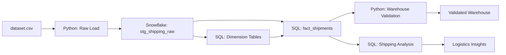
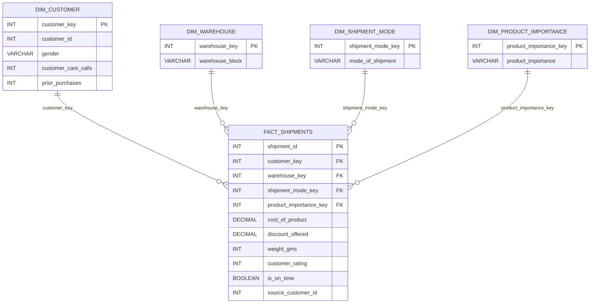

# E-Commerce Shipping Data Warehouse

A Snowflake-based data warehouse project for analyzing e-commerce shipping and logistics performance.

The project loads an e-commerce shipping dataset into Snowflake, transforms raw records into a star schema, validates warehouse quality, and provides SQL analyses for delivery outcomes, shipment modes, warehouse blocks, product importance, discounts, and product weight.

**Tech Stack:** Snowflake, SQL, Python, Pandas, SQLAlchemy

---

## Project Overview

The goal of this project is to convert raw e-commerce shipping data into an analytics-ready warehouse that supports operational reporting.

The pipeline processes approximately **11,000 shipping records** across **12 source fields**. It uses Python to load the raw CSV into Snowflake and SQL to build dimension tables and a central shipment fact table.

---

## Architecture



---

## Data Flow

```text
dataset.csv
    ↓
Python loads raw CSV into Snowflake
    ↓
stg_shipping_raw
    ↓
Dimension tables:
- dim_customer
- dim_warehouse
- dim_shipment_mode
- dim_product_importance
    ↓
fact_shipments
    ↓
Validation checks and logistics-analysis SQL queries
```

---

## Star Schema

The warehouse uses a star schema with a central shipment fact table and four descriptive dimensions. A star schema organizes measurable events in a fact table and connects them to smaller dimension tables containing descriptive attributes. [Snowflake: Star Schema](https://www.snowflake.com/en/fundamentals/star-schema/)



### Warehouse Tables

| Table | Grain | Purpose |
|---|---|---|
| `stg_shipping_raw` | One raw source record | Landing table loaded directly from the CSV |
| `dim_customer` | One unique source ID | Customer-related attributes from the source data |
| `dim_warehouse` | One warehouse block | Warehouse or fulfillment-block labels |
| `dim_shipment_mode` | One shipment mode | Shipment-method labels |
| `dim_product_importance` | One importance category | Product-priority labels |
| `fact_shipments` | One source shipping record | Shipment measures, delivery outcome, and dimension keys |

> **Data-model note:** The source `ID` is preserved as `source_customer_id` for traceability. Unless the original dataset confirms it represents repeat customers, it should be treated as a source-record identifier rather than proof of customer-level history.

---

## Source Dataset

The dataset contains approximately **11,000 records** and these 12 source fields:

| Source Field | Description |
|---|---|
| `ID` | Source record identifier |
| `Warehouse_block` | Warehouse or fulfillment-block label |
| `Mode_of_Shipment` | Shipping method |
| `Customer_care_calls` | Number of customer-care contacts |
| `Customer_rating` | Customer rating |
| `Cost_of_the_Product` | Product cost |
| `Prior_purchases` | Prior purchase count |
| `Product_importance` | Product-priority category |
| `Gender` | Customer gender |
| `Discount_offered` | Discount percentage |
| `Weight_in_gms` | Product weight in grams |
| `Reached.on.Time_Y.N` | Source delivery-outcome indicator |
