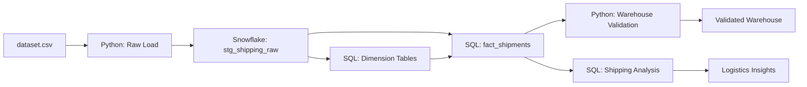
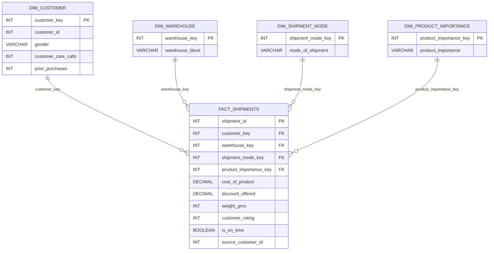

# E-Commerce Shipping Data Warehouse

A Snowflake-based data warehouse project for analyzing e-commerce shipping and logistics performance.

The project loads an e-commerce shipping dataset into Snowflake, transforms raw records into a star schema, validates warehouse quality, and provides SQL analyses for delivery outcomes, shipment modes, warehouse blocks, product importance, discounts, and product weight.

**Tech Stack:** Snowflake, SQL, Python, Pandas, SQLAlchemy

---

## Project Overview

The goal of this project is to convert raw e-commerce shipping data into an analytics-ready warehouse that supports operational reporting.

The pipeline processes approximately **11,000 shipping records** across **12 source fields**. It uses Python to load the raw CSV into Snowflake and SQL to build dimension tables and a central shipment fact table.

---

## Architecture



---

## Data Flow

```text
dataset.csv
    ↓
Python loads raw CSV into Snowflake
    ↓
stg_shipping_raw
    ↓
Dimension tables:
- dim_customer
- dim_warehouse
- dim_shipment_mode
- dim_product_importance
    ↓
fact_shipments
    ↓
Validation checks and logistics-analysis SQL queries
```

---

## Star Schema

The warehouse uses a star schema with a central shipment fact table and four descriptive dimensions. A star schema organizes measurable events in a fact table and connects them to smaller dimension tables containing descriptive attributes. [Snowflake: Star Schema](https://www.snowflake.com/en/fundamentals/star-schema/)



### Warehouse Tables

| Table | Grain | Purpose |
|---|---|---|
| `stg_shipping_raw` | One raw source record | Landing table loaded directly from the CSV |
| `dim_customer` | One unique source ID | Customer-related attributes from the source data |
| `dim_warehouse` | One warehouse block | Warehouse or fulfillment-block labels |
| `dim_shipment_mode` | One shipment mode | Shipment-method labels |
| `dim_product_importance` | One importance category | Product-priority labels |
| `fact_shipments` | One source shipping record | Shipment measures, delivery outcome, and dimension keys |

> **Data-model note:** The source `ID` is preserved as `source_customer_id` for traceability. Unless the original dataset confirms it represents repeat customers, it should be treated as a source-record identifier rather than proof of customer-level history.

---

## Source Dataset

The dataset contains approximately **11,000 records** and these 12 source fields:

| Source Field | Description |
|---|---|
| `ID` | Source record identifier |
| `Warehouse_block` | Warehouse or fulfillment-block label |
| `Mode_of_Shipment` | Shipping method |
| `Customer_care_calls` | Number of customer-care contacts |
| `Customer_rating` | Customer rating |
| `Cost_of_the_Product` | Product cost |
| `Prior_purchases` | Prior purchase count |
| `Product_importance` | Product-priority category |
| `Gender` | Customer gender |
| `Discount_offered` | Discount percentage |
| `Weight_in_gms` | Product weight in grams |
| `Reached.on.Time_Y.N` | Source delivery-outcome indicator |

### Delivery Outcome Mapping

The warehouse derives `is_on_time` from the source delivery indicator:

| Source value | `is_on_time` |
|---:|---|
| `0` | `TRUE` |
| `1` | `FALSE` |

```sql
CASE
    WHEN s.reached_on_time_yn = 0 THEN TRUE
    WHEN s.reached_on_time_yn = 1 THEN FALSE
    ELSE NULL
END AS is_on_time
```

---

## Repository Structure

```text
ecommerce-shipping-data-warehouse/
├── README.md
├── requirements.txt
├── .gitignore
├── .env.example
│
├── data/
│   └── dataset.csv
│
├── src/
│   ├── load_raw_to_snowflake.py
│   └── validate_warehouse.py
│
└── sql/
    ├── 01_create_tables.sql
    ├── 02_load_dimensions.sql
    ├── 03_load_fact_shipments.sql
    └── 04_shipping_analysis.sql
```

---

## Pipeline Execution

Run the project in this order.

### 1. Configure environment variables

Create a local `.env` file:

```text
SNOWFLAKE_ACCOUNT=<your_account>
SNOWFLAKE_USER=<your_username>
SNOWFLAKE_PASSWORD=<your_password>
SNOWFLAKE_DATABASE=<your_database>
SNOWFLAKE_SCHEMA=ECOM_DW
SNOWFLAKE_WAREHOUSE=<your_warehouse>
SNOWFLAKE_ROLE=<your_role>
```

Do not commit `.env` or Snowflake credentials.

### 2. Install dependencies

```bash
python -m venv .venv
source .venv/bin/activate
pip install -r requirements.txt
```

For Windows PowerShell:

```powershell
.venv\Scripts\Activate.ps1
pip install -r requirements.txt
```

### 3. Load raw data

```bash
python src/load_raw_to_snowflake.py
```

This loads `data/dataset.csv` into `stg_shipping_raw`.

### 4. Create warehouse tables

Run this file in a Snowflake worksheet:

```text
sql/01_create_tables.sql
```

### 5. Load dimensions

Run:

```text
sql/02_load_dimensions.sql
```

### 6. Load shipment facts

Run:

```text
sql/03_load_fact_shipments.sql
```

### 7. Validate the warehouse

```bash
python src/validate_warehouse.py
```

Validation checks include:

- Staging and fact-table row counts match.
- Shipment IDs are unique.
- Foreign keys in `fact_shipments` are not null.
- Required numeric shipment measures are not null.
- Delivery outcome is valid.
- Every staging record has a corresponding fact record.

### 8. Run logistics analyses

Run:

```text
sql/04_shipping_analysis.sql
```

---

## Example Analyses

The project includes SQL queries for:

- Overall shipment volume and on-time delivery rate.
- Delivery performance by shipment mode.
- Delivery performance by warehouse block.
- Delivery performance by product importance.
- Comparison of product cost, discount, weight, and rating by delivery outcome.
- Customer-care call patterns by delivery outcome.

Example query:

```sql
SELECT
    m.mode_of_shipment,
    COUNT(*) AS total_shipments,
    ROUND(
        100.0 * COUNT_IF(f.is_on_time = TRUE) / COUNT(*),
        2
    ) AS on_time_delivery_rate_pct
FROM fact_shipments AS f
JOIN dim_shipment_mode AS m
    ON f.shipment_mode_key = m.shipment_mode_key
GROUP BY m.mode_of_shipment
ORDER BY on_time_delivery_rate_pct DESC;
```

---

## Data Quality

The project validates row counts, key uniqueness, required values, and staging-to-fact completeness.

Because Snowflake standard-table primary and foreign-key constraints are generally informational rather than automatically enforced, the Python validation script explicitly checks data integrity after loading. [Snowflake constraints documentation](https://docs.snowflake.com/en/sql-reference/constraints-overview)

---

## Key Skills Demonstrated

- Snowflake data warehouse design.
- Dimensional modeling with fact and dimension tables.
- Python-based CSV ingestion with Pandas and SQLAlchemy.
- SQL transformation from raw staging data into a star schema.
- Surrogate-key creation with `ROW_NUMBER()`.
- Data validation and reconciliation.
- Logistics and shipping-performance analysis.
- Reproducible, version-controlled SQL and Python workflows.

---

## Future Improvements

- Add automated orchestration with Apache Airflow.
- Add incremental data loading instead of full table replacement.
- Add dbt transformations and tests.
- Add a Power BI or Streamlit dashboard.
- Add GitHub Actions for automated validation checks.
- Add more source datasets and a date dimension for time-based reporting.

---

## Author

**Hoa Ho**  
Aspiring Data Engineer

- GitHub: [@<your-github-username>](https://github.com/<your-github-username>)
- LinkedIn: [<your-linkedin-profile>](https://linkedin.com/in/<your-linkedin-profile>)

---

## Disclaimer

This project is for educational and portfolio purposes. It uses public or learning-oriented e-commerce shipping data and does not contain proprietary business data.
